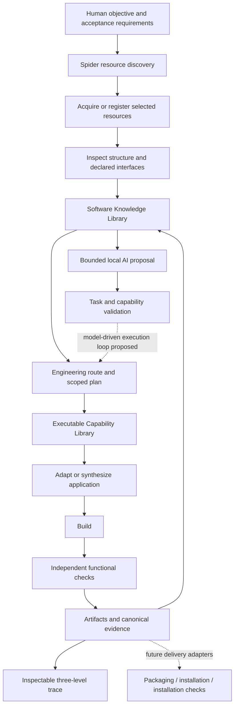

# Spider Creator Engine architecture

SCE is a local-first software discovery, engineering intelligence, and creation
platform. Its architecture connects human objectives to reusable software
knowledge, explicit engineering decisions, component construction, and observed
functional results. The v0.1 orchestrator remains execution infrastructure for
that larger product. The v0.2 milestone introduces a bounded Spider workflow.

Python 3.11+ and the standard library provide the host runtime. Replaceable
adapters allow Python, Rust, PowerShell, C++, .NET, or independently developed
components to retain their own implementations. Integration follows inspected
interfaces rather than a requirement to rewrite every engine in Python.

## Product flow

The concrete local creation route uses human-selected Python callable components
and a caller-supplied input/expected-output pair. It discovers and snapshots the
sources, inspects them, creates a thin JSON bridge in a fresh workspace, builds an
archive, runs the declared functional check, and persists evidence. Choosing
arbitrary components from a natural-language request and generating missing source
are proposed extensions to this implemented route.

## Modules and evidence boundaries

| Module | Implemented role | Boundary |
| --- | --- | --- |
| `discovery` | Starting-point normalization, local static inspection, public GitHub account/repository/keyword discovery | Bounded pinned trees/root documents; no general semantic research or remote execution |
| `acquisition` | Local file/directory snapshots with identities, hashes, and transfer evidence | Network acquisition and archive extraction proposed |
| `analysis` | Static project structure, language, dependency, and build metadata observations | Declarations and filename clues do not prove compatibility |
| `synthesis` | Explicit Python callable components, source selection, isolated namespaces, generated JSON bridge | Controlled interface class; no source generation by a model |
| `builders` / `adapters` | Common contract, controlled Python archive builder, optional inspected installed-QASC CLI bridge | QASC generation needs separate functional qualification; general build backends and .NET proposed |
| `verification` | Separate subprocess checks against declared stdout/exit requirements | One acceptance case qualifies one observed result; no sandbox |
| `knowledge` / `recovery` | Provenance categories, resource indexes, typed relationships, applicability, human corrections, failure capsules | Retrieval supports engineering judgment; automatic diagnosis and repair proposed |
| `capabilities` | Contracts, implementation status, availability, evidence, and limitations | Registry presence is not functional proof |
| `ai` | Provider-independent proposals and evidence interpretation, loopback probing, bounded context, exact input-scope validation | Interpretations remain inference; live models and independent external adapters need qualification |
| `orchestration` | Task DAGs, attempts, checkpoints, cancellation, conservative resume | Sequential execution; one owner per task |
| `storage` | Local task and operation database | Additive memory/trace schema changes; full migration/backup tooling proposed |
| `reporting` | Canonical operation JSON/Markdown/HTML and three-level trace | Operation outcome and verification remain separate |
| `resources` / `core` | Configuration, portable data models, timing, environment observation, declared budgets | Memory/GPU/disk quotas advisory; no fabricated measurements |
| `cli` | Discover, create from selected components, inspect memory/trace, and foundation operations | A practical bounded workflow rather than general autonomous product negotiation |

## Discovery and source understanding

Starting points include local paths, repository URLs, `owner/repository`, GitHub
account URLs or `@username`, and project/objective text. Online discovery requires
an explicit opt-in. Natural-language text currently becomes a literal GitHub
keyword query; semantic request decomposition is proposed. SourceForge,
MediaFire, arbitrary URLs, and unsupported GitHub URL forms are classified with
explicit unsupported results rather than treated as implemented connectors.

Public GitHub observations use anonymous read-only REST requests, request/response
budgets, a pinned commit, its source tree, and verified blob identities for selected
root documents. They record metadata, source paths, language clues, README and
supported manifest declarations. Releases, full repository acquisition, and
arbitrary source-file interpretation require further adapters. Local inspection
uses a bounded file set and content-derived observation identity, reporting
exclusions and incomplete inventories. A local archive is identified, not extracted.

Both routes produce structured resources and attributable observations. They do
not import selected source. The static analysis layer preserves the distinction
between observed structure, author declarations, AI inference, and tested behavior.

## Creation and the adapter contract

The common engine contract is `DESCRIBE → PREPARE → EXECUTE → VERIFY → REPORT`.
`PREPARE` validates and returns an inspectable plan without performing execution.
Synthesis copies selected source into a new workspace and writes a fixed bridge;
its own verification checks construction integrity. A separate builder creates
an archive; separate functional checks execute it against declared requirements.
Changes to prepared source or generated effects invalidate the plan.

`BUILD_ORIGINAL_PROJECT` means building the selected project itself.
`CREATE_NEW_APPLICATION_USING_PROJECT` means constructing a new application using
selected components. The latter preserves component identities and revisions in
application provenance. Neither operation implies installation.

Python component interfaces are explicit `module:function` callables accepting one
JSON object; intermediate results must also be JSON objects. Source files are
selected explicitly, package imports must suit isolated namespaces, and ambient
dependencies are not silently installed. CLI/API wrappers, generated missing
components, cross-language bridges, and hybrid creation will extend these contracts
as separately qualified capabilities.

An optional `PythonQASCAdapter` uses the independently installed QASC CLI through
an explicitly selected interpreter. Generation and later functional verification
produce separate canonical records. Generated source requires explicit trust
before execution, and independent acceptance expectations remain separate from
model-authored tests. The adapter does not modify the external project or its
environment. This narrow integration does not establish general autonomous
source adaptation or successful live inference without a corresponding receipt.

Independent stages include discovery, acquisition, analysis, adaptation, synthesis,
build, functional verification, packaging, installation, installation verification,
and AI capability registration. Not every task needs every stage. Download-only,
build-existing-project, create-new-application, package-application, and register-
capability are distinct objectives; only implemented adapters can execute a stage.

## Memory, AI, and living evidence

Knowledge records preserve original claims and provenance, resource identity and
revision, evidence, environment, applicability conditions, related records, known
limits, and recording time. Typed relationships connect those records. Explicit
historical retrieval is bounded by resource identity, task scope, record count,
and serialized character budget. A reusable repair candidate can be matched,
incompatible, or unknown under observed conditions; none of those labels is a
verified repair. Human corrections append attributable contradiction links.

The model receives relevant records rather than entire repositories. Qwen at
`http://127.0.0.1:8080` is a configuration candidate that must be probed; an endpoint
listing is not proof of reasoning quality or successful inference. Proposed
actions pass task/capability/input validation. Actual results belong in evidence
before any model interpretation. Model-generated source cannot expand authority.
The implemented `interpret(TaskContext)` method returns a structured summary,
unknowns, and suggested diagnostic checks from supplied records. That output is
AI inference with no execution authority. The complete model-driven proposal,
validated execution, interpretation, and next-action loop remains staged work.

A trace exposes: (1) what happened, (2) why that route was chosen, and (3) supporting
evidence. It retains planned, executed, verified, failed, not-run, and inconclusive
states while preserving independent operation outcomes and verification statuses.
Trace writes are not the same transaction as every external effect; canonical
checkpoints remain necessary for interruption reconciliation.

## State, resources, and continuity

Task states are `pending`, `running`, `completed`, `failed`, `cancelled`, and
`blocked`. The engine records running attempts and atomically saves canonical
operation/task checkpoints. A completed step needs a successful outcome and passed
declared verification. Retries require an explicitly retry-safe failed operation
and remaining attempts. Partial execution and ambiguous interrupted stages block
for reconciliation. Cancellation is cooperative; automatic rollback and general
process-tree containment are not implemented.

Every managed category has an independent configured location: task database,
resource library, download cache, build workspaces, dependency environments,
artifacts, models, model cache, indexes, temporary data, logs, reports, and
installation destinations. Several categories reserve locations for future
adapters; configuration alone does not implement them. Unusable paths fail at
the selected location without silently redirecting storage to another volume.

Environment observations record available tools, Python/platform, memory/CPU, and
optional GPU data. Reported hardware is not assumed to be observed availability.
Current execution is serial; configurable worker/build counts do not imply parallel
scheduling. Context/output limits, timeouts, and retry budgets are consumed by
their callers. RAM/GPU/temporary-storage quotas remain advisory.

Local memory, source inspection, synthesis, builds, and reporting require no cloud
service. Offline operation additionally depends on an installed interpreter and
local dependencies. The local creation route passed a real disconnected Docker
qualification; see [scope and evidence](OFFLINE.md). Portable knowledge export, dependency mirroring,
backup/restore validation, and wider offline toolchains are roadmap work.

## Verification references

The [adapter contract](ADAPTER_CONTRACT.md), [knowledge system](KNOWLEDGE_SYSTEM.md),
[local AI boundary](LOCAL_AI.md), and [experiments](EXPERIMENTS.md) define specific
contracts and limitations. [Acceptance evidence](ACCEPTANCE_V0.2.md) records observed
results; historical foundation receipts do not qualify later capabilities.
