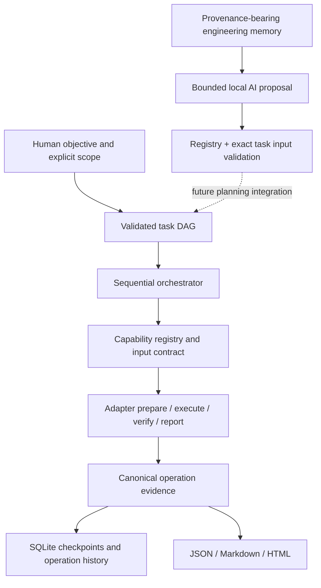

# Foundation architecture

SCE v0.1 uses Python 3.11+ and the standard library at runtime. Build/test dependencies
are development-only. Replaceable adapters avoid coupling orchestration to a language
toolchain or model provider. Existing Rust components may remain in Rust when future
interface inspection supports an integration.

## Implemented boundaries

| Module | Implemented role | Important limitation |
| --- | --- | --- |
| `core` | Typed tasks, timing, operation records, TOML configuration | No automatic baseline estimates |
| `orchestration` | DAG ordering, attempts, checkpoints, cancellation, conservative resume | Sequential, one owner per task; no distributed lease |
| `storage` | SQLite task and operation persistence | Local database, no schema migration framework yet |
| `capabilities` | Input/output descriptions, implementation state, availability, evidence | Implemented does not imply verified in this environment |
| `knowledge` / `recovery` | Provenance, contradictions, bounded retrieval, unresolved capsules | Explicit ingestion; no automatic repair selection |
| `discovery` | Provider protocol and explicit local paths | GitHub/SourceForge/forums/URL connectors proposed |
| `acquisition` | Provider protocol and bounded local file/directory snapshots | No HTTP downloader, archive extraction, repository category selection |
| `analysis` | Bounded static filename/metadata observations | Interfaces/tool requirements remain incomplete or inferred |
| `adapters` / `builders` | Common contract and controlled Python zipapp builder | .NET and new-application synthesis unavailable |
| `verification` | Declared subprocess stdout/exit verification, cancellation, timeout | Reviewed code only; no security sandbox or process-tree isolation |
| `reporting` | Canonical JSON, Markdown, HTML | Runtime receipts can contain source paths/output; review before sharing |
| `ai` | Local provider protocol, bounded structured proposals, exact scope checks | No autonomous approval/execution or final interpretation loop |
| `resources` | Runtime observations and configured budgets | RAM/GPU/temp quotas advisory, no OS enforcement |

Synthesis has no empty placeholder module. Its capability descriptor and roadmap
state are proposed. A future synthesis adapter should use thin CLI/API bridges or
intermediate representations with independently verified contracts.

## State and recovery

Task states are `pending`, `running`, `completed`, `failed`, `cancelled`, and `blocked`.
Before execution, the engine saves the running step and increments its attempt count.
After execution, a single transaction saves the canonical operation and task state.
Completion requires a successful operation with passed declared verification.
Operation outcome and verification remain independent: `succeeded` + `failed` is
valid when packaging succeeded but functional checks failed.

Retries require a failed outcome, an explicit adapter `retry_safe` declaration, and
a remaining bounded attempt budget. Partial operations and interrupted running steps
require reconciliation. Cancellation is cooperative at stage boundaries and during
the direct verification subprocess. Stopping a descendant process tree is not
implemented. Concurrent runners for one task are outside the v0.1 contract.

## Resource and storage policy

Every managed storage category is independently configurable, including database,
resource library, caches, build workspaces, dependency environments, artifacts,
models, indexes, temporary data, logs, and reports. Some categories reserve locations
for future adapters; configuration does not claim corresponding features exist.
Resource UUIDs and content hashes are separate from their current filesystem location.
Selected paths are never silently redirected to another volume.

Execution is currently serial regardless of larger configured worker/build counts.
The CLI applies timeout and retry settings; AI requests apply context/output bounds.
RAM, GPU memory, and aggregate temporary-storage quotas are declared advisory. No
Qwen offload layout is assumed or changed. `sce doctor` records live observations
without inferring that adequate resources are reserved for SCE.

## Sources for implementation decisions

Python archives require an available Python interpreter and have limitations for
native extensions: [Python zipapp documentation](https://docs.python.org/3.14/library/zipapp.html).
The package uses a `src` layout and `pyproject.toml` metadata following the
[Python Packaging User Guide](https://packaging.python.org/en/latest/tutorials/packaging-projects/).
These sources inform packaging design; they do not establish compatibility beyond
the controlled tests in this repository.
